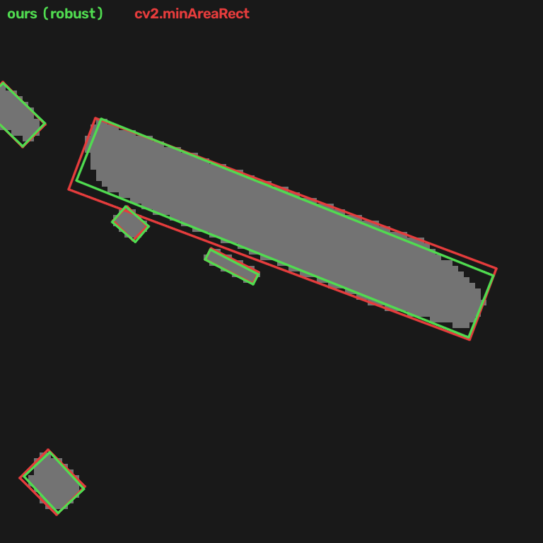

# ICEYE AI Engineer homework

This repository contains both parts of the homework as one uv project with two command-line tools:

- `ner-chat` (Part 1) extracts named entities from a document into a JSON store with Kreuzberg and GLinker, then answers one question at a time from that store with a Pydantic AI agent.
- `blob-boxes` (Part 2) finds every blob in a binary mask and writes the rotated rectangle that maximises IoU with it to `blob_bounding_boxes.csv`.

## Install

You need [uv](https://docs.astral.sh/uv/). Then:

```bash
uv sync
```

That is the only setup step. uv installs Python 3.12 if it is missing, then the exact versions pinned in `pyproject.toml` and `uv.lock`. On Linux, torch comes from the PyTorch CPU index, which avoids about 2 GB of CUDA wheels.

On macOS, the first command after a fresh `uv sync` can take a minute or two. In testing, that run used about 6 seconds of CPU and spent the rest waiting, most likely on the OS checking the newly installed native libraries; later runs start normally.

The first `ner-chat extract` downloads about 670 MB of NER weights from Hugging Face (`knowledgator/gliner-bi-edge-v2.0` and its label encoder). For images and scans it also downloads Kreuzberg's PaddleOCR models. Both are cached. `ner-chat ask`, Part 2 and the tests download nothing.

## Quick start

```bash
# Part 1: extract once, then ask (no API key needed with --model offline or --model test)
uv run ner-chat extract data/sample_report.pdf
uv run ner-chat ask "How many times is Kestrel Orbital mentioned, and is NASA?" --model offline

# Part 2: writes blob_bounding_boxes.csv
uv run blob-boxes data/example_mask.jpg

# Tests (offline, no API key)
uv run pytest
```

## Part 1: NER chatbot

### Usage

`extract` reads a document, detects entities and writes the store (default `entities.json`):

```text
$ uv run ner-chat extract data/sample_report.pdf
17 entities (27 mentions) from data/sample_report.pdf in 0.7s -> entities.json

$ uv run ner-chat extract data/sample_scan.png --store scan.json
18 entities (27 mentions) from data/sample_scan.png in 2.1s -> scan.json
```

The time shown covers text extraction and NER. Each `ner-chat` command also takes about 3.5 s to start, almost all of it spent importing torch, transformers and GLinker.

Options: `--labels person organization ...` (default: person, organization, location, date, event, product), `--threshold 0.4`, `--ner-model`, `--ocr-backend`, `--force-ocr` (OCR a PDF even if it has a text layer) and `--device cpu|cuda|mps`. Kreuzberg accepts PDFs, images, Office files, HTML and more. The default OCR backend, `paddleocr`, works after `uv sync`; `tesseract` needs the Tesseract binary and `easyocr` the `easyocr` package, neither of which is installed by this project.

`ask` answers one question from the store. Pass `--json` to print the structured answer:

```text
$ uv run ner-chat ask "Is Helsinky mentioned?" --model ollama:qwen3:14b
The name "Helsinky" isn't found, but "Helsinki" (likely the intended name) is mentioned **2 times** in the document.

  Helsinky  not mentioned (0)
  Helsinki  location, 2 mentions

$ uv run ner-chat ask "How many times are ICEYE and NASA mentioned?" --store tests/entities.json --model offline --json
{
  "reply": "Here is what the entity store says: ICEYE (organization) is mentioned 7 times. NASA is not mentioned.",
  "entities": [
    {"name": "ICEYE", "label": "organization", "mention_count": 7, "in_store": true},
    {"name": "NASA", "label": null, "mention_count": 0, "in_store": false}
  ]
}
```

(The JSON is shown compacted here; the CLI indents it.)

`--model` takes any Pydantic AI model name, or set `NER_CHAT_MODEL` instead:

| `--model` | Needs |
|---|---|
| `openai:gpt-4.1-mini` | `OPENAI_API_KEY` |
| `anthropic:claude-sonnet-4-5` | `ANTHROPIC_API_KEY` |
| `ollama:qwen3:14b` | a local Ollama server and `OLLAMA_BASE_URL=http://localhost:11434/v1` |
| `offline` | nothing: a rule-based stand-in for an LLM, built on Pydantic AI's `FunctionModel` |
| `test` | nothing: Pydantic AI's `TestModel`, which calls every tool and returns placeholder text |

`offline`, `test` and `ollama:qwen3:14b` were run against the sample stores. The OpenAI and Anthropic providers are installed and go through the same agent, but were not run here because no keys were available. The `offline` model picks names out of the question (quoted phrases or capitalised words), calls the same tools an LLM would and fills a template from the results. It is useful for trying the flow without a key; a real model handles free-form questions much better.

### How extraction works

1. Kreuzberg extracts the text. PDFs and Office files use their text layer; images and scanned PDFs go through PaddleOCR, which is bundled with Kreuzberg, so no system OCR install is needed. On `data/sample_scan.png` it read 96.7% of words correctly. Most errors were l/i swaps such as "Heisinki" for "Helsinki".
2. The text is split into chunks of up to 200 words at sentence boundaries, keeping exact character offsets. GLiNER models have a short context window.
3. GLinker's `l1_gliner` processor runs `knowledgator/gliner-bi-edge-v2.0`, a bi-encoder with a 32M-parameter Ettin text encoder and a MiniLM label encoder, on each chunk. Label embeddings are computed once and reused. GLiNER builds the encoders from their config and then loads every weight from the checkpoint, so the model is built under transformers' `no_init_weights()`, which skips the random initialisation in between. That cuts the model load from about 3 s to 0.4 s and gives a bit-identical model.
4. Mentions are grouped by a normalised name: NFKC, collapsed whitespace, edge punctuation, a trailing possessive "'s", honorifics such as "Dr." and case are all ignored. So "Dr. Aino Virtanen" and "Aino Virtanen" count as one person with two mentions. The display name is the most frequent surface form, the label is the majority label, and the other forms are kept as aliases that `ask` can look up.
5. The store is written atomically (temporary file, then rename) as JSON: `{source, model, labels, entities: [{name, label, count, aliases}]}`. A few dozen entities do not need a database, and the same format is used for the test fixture.

### How `ask` stays grounded

`ask` never opens the document, and the model never sees the entity list. Its instructions describe only the tools, and it can read the store through these four, each capped at 10 rows:

- `count_mentions(name)`: exact or alias lookup. An absent name returns `found: false`, a count of 0 and up to three spelling suggestions.
- `search_entities(query, label)`: substring, shared-word and close-spelling matches.
- `top_entities(label)`: the most mentioned entities, optionally of one label.
- `list_labels()`: entity and mention totals per label.

The output type is `Answer`: a `reply` string plus `entities`, at most 10 items of `{name, label, mention_count, in_store}`. An output validator runs on every answer before it is returned:

- Each cited entity is replaced by the store's record, with canonical name, label and count. A name the store does not have becomes `label: null, mention_count: 0, in_store: false`. Duplicates are dropped. The model cannot report a wrong count or label in `entities`, even if it tries.
- Counts quoted in the reply ("7 times", "two mentions", "twice") are checked against the counts the tools returned during the run. An unsupported number raises `ModelRetry` with the correct figures, and the model rewrites the reply (up to two retries).

Names in the free-text reply are not checked; the `entities` list is the authoritative, store-backed part of the answer. Extraction quality is bounded by GLiNER and OCR. For example, OCR turned "Helsinki team" into "Heisinki team", which GLiNER then tagged as an organization.

## Part 2: blob bounding boxes

### Usage

```bash
uv run blob-boxes data/example_mask.jpg                        # -> blob_bounding_boxes.csv
uv run blob-boxes mask.npy --out boxes.csv --overlay overlay.png
```

The mask can be a `.npy` 2D array (non-zero is foreground) or an image (grey value above `--threshold`, default 127, which also removes JPEG noise). Other options: `--objective` (see below), `--connectivity 4|8`, `--min-area`, `--restarts` (random restarts per blob, default 8; see the results below) and `--workers` (default: all CPUs). From Python:

```python
from pathlib import Path
from iceye_homework.blobs import fit_blob_boxes, write_csv

# mask: 2D NumPy array; one BlobFit(blob_id, box, area, iou, baseline_iou) per blob
fits = fit_blob_boxes(mask)
write_csv(fits, Path("blob_bounding_boxes.csv"))
```

Output for the example mask:

```text
136 blobs in 2.06s -> blob_bounding_boxes.csv
IoU mean 0.8305 / median 0.8335  (minAreaRect baseline mean 0.7179, improved on 126 of 136 blobs)

blob_id,center_x,center_y,width,height,angle
1,365.5625,256.0625,2.125,1.125,-90.0
2,507.5723,435.2879,1.4841,1.0592,24.104
...
```

The coordinates follow OpenCV's `RotatedRect`. `x` is the column and `y` the row, and pixel centres sit at integer coordinates. `width >= height`, the angle is in degrees in [-90, 90), and the width side points along (cos angle, sin angle) with y pointing down. `cv2.boxPoints(((center_x, center_y), (width, height), angle))` gives the corners. Blob ids are 1..N in raster order of each blob's first pixel. Values are rounded to 4 decimals, and the reported IoU is computed on the rounded boxes, so it can be reproduced from the CSV. Four blobs in the example are a single pixel wide; their best box has height 0, a segment that every rasterisation paints as exactly the blob, which is also what `cv2.minAreaRect` returns for them.

### Which mask does a rectangle define?

The task asks for the IoU between the blob and "the mask defined by the rectangle", but does not say how a rectangle becomes pixels. That matters here: the median blob in the example has 12.5 pixels, and on blobs that small half a pixel per side changes IoU a lot. `blob-boxes` supports four exact rasterisations:

- `center`: pixels whose centre lies inside the closed rectangle (the point-sampling rule of GDAL/rasterio and scikit-image).
- `subpixel`: `cv2.fillPoly` of the `cv2.boxPoints` polygon at 1/16-pixel precision.
- `round`: `cv2.fillPoly` of the corners rounded to integers.
- `truncate`: `cv2.fillPoly` of the corners truncated to integers, which is what `np.intp(box)` or `box.astype(int)` in the OpenCV tutorials does.

`cv2.fillPoly` paints every pixel the outline touches, so the three fill models paint about half a pixel more per side than `center`. A box tuned for one model does badly under the others (second table below). The default objective, `robust`, maximises the mean IoU over all four. It gives up some IoU under each single model, but on the example mask its mean IoU stays above `cv2.minAreaRect`'s under every one of them, which no single-model objective manages. If you know which rasterisation will be used, pass it with `--objective`.

### Algorithm

Each blob is fitted independently, in parallel processes, and the result is deterministic and independent of the number of processes.

1. Seeds. Three starting rectangles: `cv2.minAreaRect` of the pixel centres, the same rectangle grown half a pixel per side to the pixel edges, and a rectangle from the covariance eigenvalues (side = sqrt(12 x eigenvalue), exact for a solid rectangle and not inflated by stray pixels).
2. Orientation sweep. For angles every 5 degrees (plus the seed angles), the best axis-aligned rectangle in the rotated frame is found on a histogram grid with Dinkelbach's method. Maximising I / (|B| + A - I) reduces to repeatedly finding the maximum-sum subrectangle of the weights (1 + lambda) x count - lambda x cell area.
3. Refinement. Nelder-Mead on a smooth IoU in which each pixel is weighted by its area overlap with the rectangle.
4. Exact polish. Pattern search on the exact pixel IoU under the chosen rasterisation, with moves per parameter, per single side and rotations about one end. It starts from the best three candidates, then runs 8 seeded random restarts around the best box (`--restarts`). The exact IoU is piecewise constant, so ties are broken by the smooth IoU of the region the fill models paint. This keeps the search moving across flat regions and returns the box in the middle of its plateau, where rounding is least likely to change the painted pixels.

Exact scoring is most of the run time, so candidate boxes are scored in batches on a small window around the blob: one vectorised pixel-centre test, and one `cv2.fillPoly` call per fill model, with each box drawn in its own band of a stacked canvas.

The `minAreaRect` seeds stay among the candidates, so the result is never worse than `cv2.minAreaRect` (up to the 4-decimal rounding; on the example mask it is never worse under any objective).

### Results

`uv run python scripts/benchmark.py` reproduces these numbers and the figure on an Apple M3 Pro (6 performance and 6 efficiency cores; times are the best of three runs). It recomputes every IoU from the CSV boxes with full-image rasterisation and fails if any reported IoU or baseline disagrees.

Example mask (1024x1024, 136 blobs):

| Objective | Mean IoU | Median | Min | `cv2.minAreaRect` | Better than it | 1 process | 12 processes |
|---|---|---|---|---|---|---|---|
| `robust` (default) | 0.8305 | 0.8335 | 0.5848 | 0.7179 | 126/136 | 8.7 s | 2.0 s |
| `center` | 0.9548 | 1.0000 | 0.6923 | 0.7066 | 131/136 | 6.6 s | 1.9 s |
| `subpixel` | 0.8915 | 0.8881 | 0.6429 | 0.7399 | 123/136 | 7.1 s | 1.8 s |
| `round` | 0.8909 | 0.8889 | 0.6250 | 0.7395 | 122/136 | 7.2 s | 1.9 s |
| `truncate` | 0.8910 | 0.8889 | 0.6250 | 0.6855 | 130/136 | 7.4 s | 2.1 s |

The other blobs tie with `minAreaRect`; none is worse. The same boxes scored under every rasterisation (mean IoU):

| Boxes | `center` | `subpixel` | `round` | `truncate` | Worst |
|---|---|---|---|---|---|
| ours, `robust` | 0.8349 | 0.8667 | 0.8680 | 0.7521 | 0.7521 |
| ours, `center` | 0.9548 | 0.5766 | 0.5706 | 0.5550 | 0.5550 |
| ours, `subpixel` | 0.5184 | 0.8915 | 0.8358 | 0.6116 | 0.5184 |
| ours, `round` | 0.5333 | 0.8225 | 0.8909 | 0.5991 | 0.5333 |
| ours, `truncate` | 0.5070 | 0.7651 | 0.7689 | 0.8910 | 0.5070 |
| `cv2.minAreaRect` | 0.7066 | 0.7399 | 0.7395 | 0.6855 | 0.6855 |

More random restarts keep finding small gains. They never lower a blob's IoU, because each blob's random sequence is fixed and a restart only replaces the incumbent if it scores higher (`robust`, 12 processes):

| `--restarts` | Mean IoU | Blobs better than with 8 | Time |
|---|---|---|---|
| 0 | 0.8151 | 0 (74 worse) | 1.2 s |
| 8 (default) | 0.8305 | - | 2.1 s |
| 16 | 0.8328 | 27 | 3.0 s |
| 32 | 0.8348 | 40 | 5.2 s |
| 64 | 0.8359 | 52 | 9.0 s |

As a correctness check with known answers, 200 random rectangles (2-40 px by 1-12 px, any angle) were painted with each rasterisation and fitted with the matching objective. All 200 came back with IoU 1 under `subpixel`, `round` and `truncate`, and 199 under `center`, where the worst was 0.9933.



The figure shows the window of the example mask where the fit gains most. On the long blob, `cv2.minAreaRect` has to cover a few stray pixels and becomes much wider than the blob; the IoU-optimal box leaves them out.

## Tests

```bash
uv run pytest
```

There is one test per part, and both run offline with no API key in about 5 seconds.

- `tests/test_part1_ask.py` runs the `ask` path against the fixture store `tests/entities.json` with Pydantic AI's `TestModel` and real model requests disabled. The model cites a known entity by its alias, with the wrong label and count, and an absent name. The test checks that the answer reports the store's count for the known name and 0 / not in the store for the absent one, that the tools were used, and that no store entity appears in the prompt. It also runs the CLI with `--model test`.
- `tests/test_part2_blobs.py` paints three rotated rectangles with `cv2.fillPoly` and checks that they are recovered with IoU 1. It adds a square with a one-pixel spur, where the fit must beat `cv2.minAreaRect` clearly, and checks the CLI's CSV header and angle range.

## Repository layout

```text
src/iceye_homework/
  ner/            Part 1: extract.py (Kreuzberg + GLinker), store.py, models.py,
                  agent.py (tools, grounding validator), offline.py, cli.py
  blobs/          Part 2: fit.py (search), geometry.py (rasterisation, exact IoU), io.py, cli.py
tests/            entities.json fixture, one test per part
data/             example_mask.jpg (from the brief), sample_report.pdf, sample_scan.png
scripts/          benchmark.py (Part 2 numbers and figure), make_samples.py (sample documents)
docs/             blobs_zoom.png
```

`data/sample_report.pdf` is a fictional one-page report with a text layer, and `data/sample_scan.png` is the same page rasterised at 150 dpi, slightly rotated and blurred, to exercise OCR. `uv run scripts/make_samples.py` regenerates both; its dependencies, including PyMuPDF, are declared inline (PEP 723) so they stay out of the project. Code style is checked with `uv run ruff check` and `uv run ruff format --check`.

## Requirement checklist

| Requirement | Where |
|---|---|
| uv + `pyproject.toml`, `uv sync` only, no `requirements.txt` | `pyproject.toml`, `uv.lock` |
| Python 3.12 or 3.13 | `requires-python = "==3.12.*"`, `.python-version` |
| Every dependency pinned exactly | `==` pins in `pyproject.toml`, including dev tools and the build backend |
| `/tests` with one unit test per task | `tests/test_part1_ask.py`, `tests/test_part2_blobs.py` |
| Part 1: Kreuzberg, then GLinker, then a local store; no single-call detect-and-answer | `ner/extract.py`, `ner-chat extract` |
| Part 1: `ask` reads only the store, through tools, without the inventory in the prompt | `ner/agent.py` (four capped tools, instructions without entities) |
| Part 1: structured reply with the entities used (name, label, count); absent name gives 0 | `Answer` in `ner/models.py`, `ground_answer` in `ner/agent.py` |
| Part 1: fixture test with `--model test` / `TestModel`, known and absent names, no key | `tests/entities.json`, `tests/test_part1_ask.py` |
| Part 2: blobs in a 2D NumPy mask, IoU-maximising rotated rectangle per blob | `blobs/fit.py`, `fit_blob_boxes` |
| Part 2: `blob_bounding_boxes.csv` with `blob_id, center_x, center_y, width, height, angle` | `blobs/io.py`, `blob-boxes` |
| README with install, run and test instructions | this file |
